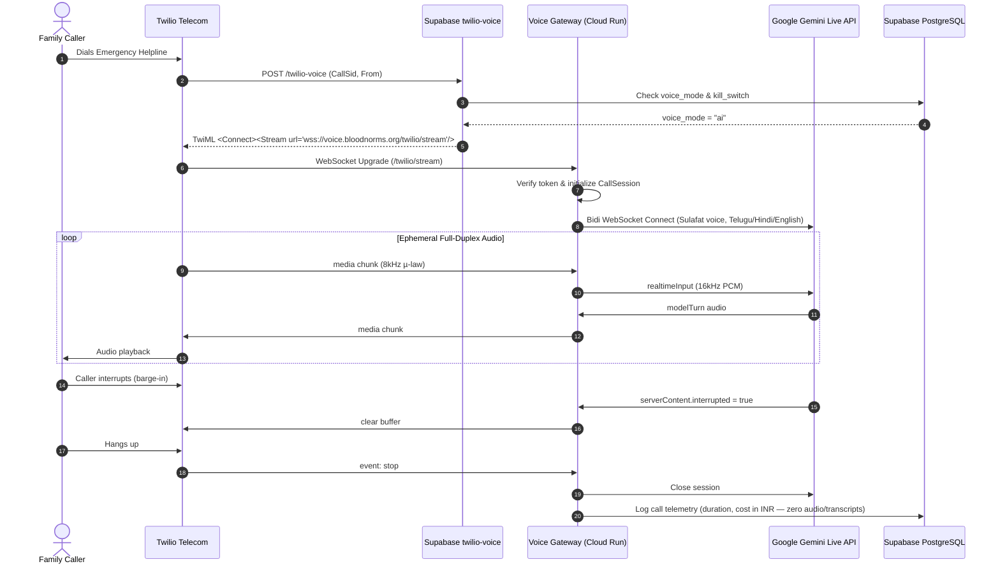

# BloodNorms — System Architecture & Design Specification

## 1. High-Level Architecture Overview

BloodNorms is an emergency blood-donor matching platform designed for rapid, honest, and privacy-preserving response during life-threatening medical crises in India.

```mermaid
flowchart TD
    subgraph Clients["1. Cross-Platform Clients (Flutter 3.44)"]
        RequesterApp["Emergency Requester Flow (/ /group /units /location /live)"]
        DonorApp["Volunteer Donor Portal (/donor /ticket /camps)"]
        BankConsole["Blood Bank Staff Console (/bank)"]
        AdminCockpit["Executive Operations Center (/admin)"]
    end

    subgraph Edge["2. Edge Functions & Microservices"]
        VoiceGateway["Cloud Run Voice Gateway\n(Node.js 22 + WebSockets)"]
        WhatsAppWebhook["Supabase Edge Function:\nwhatsapp-webhook"]
        TwilioVoice["Supabase Edge Function:\ntwilio-voice"]
        EngineTick["Supabase Edge Function:\nengine-tick (20s Lease Loop)"]
    end

    subgraph Data["3. Supabase Relational & Geospatial Core"]
        Postgres["PostgreSQL 15 + PostGIS\n(ST_DWithin Spatial Indexing)"]
        RLS["Row Level Security & DPDP Encryption"]
        AuditLog["Immutable Audit Chain (trg_audit_logs_immutable)"]
    end

    subgraph External["4. Third-Party Integrations"]
        Twilio["Twilio Programmable Voice & IVR"]
        Gemini["Google Gemini Live Speech-to-Speech API"]
        MetaWA["Meta WhatsApp Cloud API"]
        OSM["OpenStreetMap & Nominatim Geocoding"]
    end

    RequesterApp -->|OpenStreetMap Tiles| OSM
    RequesterApp -->|PostgREST & Realtime| Postgres
    DonorApp -->|PostgREST & Realtime| Postgres
    BankConsole -->|RPC stock management| Postgres
    AdminCockpit -->|Four-Eyes Governance| Postgres

    Twilio -->|Audio WebSockets| VoiceGateway
    VoiceGateway <-->|BidiGenerateContent| Gemini

    Twilio -->|Call Webhooks| TwilioVoice
    MetaWA -->|Inbound Webhooks| WhatsAppWebhook
    MetaWA <-->|Template Alerts & Updates| Postgres

    EngineTick -->|Claim 20s lease| Postgres
```

---

## 2. Inbound Voice Call Sequence Diagram

When a stressed family member dials the emergency helpline (+91 883 247 1234), the call is handled with zero credential exposure:

---

## 3. The Concentric Search Rings & Gates Engine

The matching engine expands outward in 14 concentric geographical rings per Rule BR-06:

| Ring # | Radius (km) | Gate Check | Rule |
|---|---|---|---|
| 1 | 0.5 km | Auto | Walking distance / immediate vicinity |
| 2 | 1.0 km | Auto | Neighborhood |
| 3 | 2.0 km | Auto | Locality |
| 4 | 3.0 km | Auto | Sub-district |
| 5 | 5.0 km | Auto | City sector |
| 6 | 10.0 km | Auto | Municipal limits |
| 7 | 15.0 km | Auto | Urban agglomeration |
| 8 | 20.0 km | Auto | Greater city |
| 9 | 30.0 km | Auto | Peripheral towns |
| 10 | 40.0 km | Auto | Inter-town highway |
| 11 | 50.0 km | Auto | District core |
| 12 | 70.0 km | ⚠️ Gate 1 | Requires Requester Confirmation |
| 13 | 90.0 km | ⚠️ Gate 2 | Requires Requester Confirmation |
| 14 | 100.0 km | ⚠️ Gate 3 | Final Boundary Gate |

- **Wave Multiplier:** 3x needed units are contacted per wave (BR-05).
- **Safety Cap:** Maximum 30 contacts per request to protect volunteer donors from notification fatigue.
