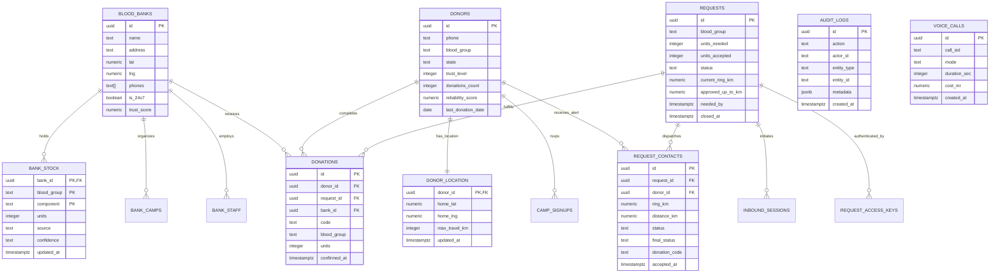

# BloodNorms Backend & Database Architecture — Schema Specification

**Engine:** PostgreSQL 17 + PostGIS  
**Schema Namespace:** `public` (Application Domain), `storage` (Binary Assets), `auth` (Identity)  
**Security Model:** Deny-First Row Level Security (RLS) on all exposed tables

---

## 1. Entity-Relationship Architecture

---

## 2. Table-by-Table Technical Specifications

### 2.1 `public.blood_banks`
- **Description:** Verified hospital blood banks, regional blood centers, and storage facilities.
- **Primary Key:** `id` (UUID).
- **Spatial Coordinates:** `lat` (double precision), `lng` (double precision), `location` (geography point).
- **RLS Access:** `SELECT` allowed for all users (`anon`, `authenticated`). `INSERT/UPDATE/DELETE` restricted to admins.

### 2.2 `public.bank_stock`
- **Description:** Real-time unit availability per blood group and component.
- **Composite Primary Key:** `(bank_id, blood_group, component)`.
- **Foreign Key:** `bank_id` references `blood_banks(id)` on delete cascade.
- **Covering Index:** Compound lookup on `(bank_id, blood_group)`.
- **RLS Access:** `SELECT` open for public discovery; `UPDATE` strictly restricted to verified `bank_staff` or administrators.

### 2.3 `public.donors`
- **Description:** Registered voluntary blood donors with verification and reliability metrics.
- **Primary Key:** `id` (UUID).
- **Security Constraints:** Health questionnaire answers are strictly forbidden from this table. Plaintext phone numbers are masked in administrative views.
- **RLS Access:** `INSERT` open for volunteer onboarding. `SELECT` restricted to self-profile or authenticated administrative review.

### 2.4 `public.donor_location`
- **Description:** Geographic home station and maximum voluntary dispatch radius.
- **Primary Key & Foreign Key:** `donor_id` references `donors(id)` on delete cascade.
- **Covering Index:** `idx_donor_location_donor_id`.

### 2.5 `public.requests`
- **Description:** Emergency blood requirements driving the 14 concentric search rings.
- **Primary Key:** `id` (UUID).
- **State Machine:** `open` -> `searching` -> `enough_donors` -> `closed` / `expired`.

### 2.6 `public.request_contacts`
- **Description:** In-flight donor contact attempts, wave responses, and donation verification codes.
- **Primary Key:** `id` (UUID).
- **Foreign Keys:** `request_id` references `requests(id)`, `donor_id` references `donors(id)`.
- **Covering Indexes:** `idx_request_contacts_request_id`, `idx_request_contacts_donor_id`.

### 2.7 `public.audit_logs`
- **Description:** Immutable system audit trail capturing administrative mutations.
- **Primary Key:** `id` (UUID).
- **Immutability Guarantee:** Database trigger `trg_audit_logs_immutable` raises exception `42501` on any attempt to execute `UPDATE` or `DELETE`.
- **RLS Access:** `SELECT` restricted to verified administrators (`is_admin()`). Anonymous access strictly denied.

