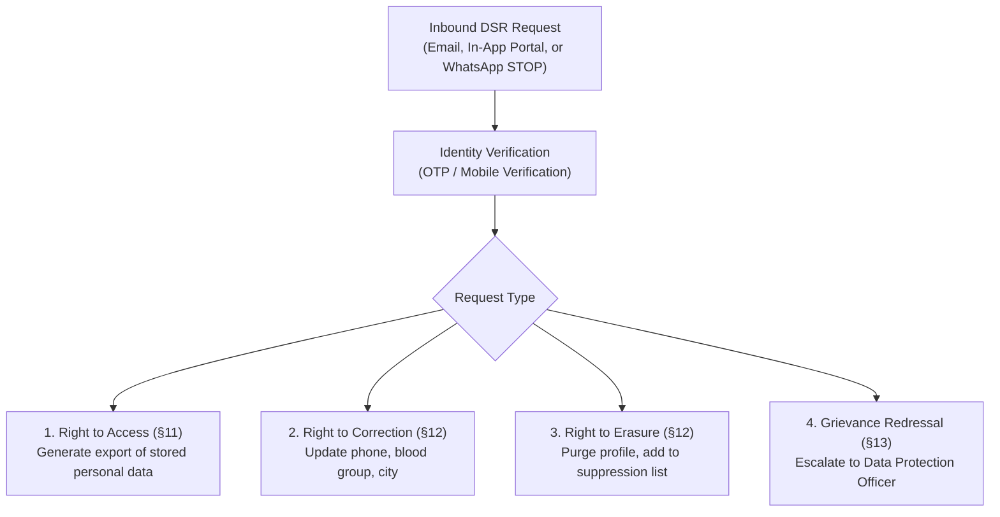

# BloodNorms — Data Subject Requests (DSR) & Rights Procedure (DATA_SUBJECT_REQUESTS.md)

**Role:** Data Protection Officer (DPO) & SRE Operations  
**Governing Regulation:** DPDP Act 2023, Sections 11, 12, 13, and 14  
**Version:** 1.0.0

---

## 1. Scope of Data Principal Rights

Every donor, patient family, and volunteer interacting with BloodNorms possesses guaranteed legal rights:

---

## 2. Standard Operating Procedures (SOPs)

### SOP 1: Immediate Opt-Out via WhatsApp (`STOP`)
- When a user replies `STOP` or `UNSUBSCRIBE` to any WhatsApp template alert:
  1. The `whatsapp-webhook` Edge Function captures the text event.
  2. The phone number is cryptographically hashed with SHA-256.
  3. An entry is upserted into `suppression_list` with `reason = 'user_opt_out'`.
  4. A confirmation template is sent: *"You have been unsubscribed from BloodNorms emergency alerts. Reply START to resubscribe."*
  5. The matching engine checks `check_phone_suppressed(hash)` before including donors in future search rings.

### SOP 2: Right to Erasure (Account Deletion)
- When a registered volunteer requests complete removal:
  1. The DPO verifies ownership via SMS OTP.
  2. The donor row in `donors` is deleted (`DELETE FROM donors WHERE id = ...`).
  3. Any active match invitations are unassigned.
  4. The phone number hash is added to `suppression_list`.
  5. Immutable transaction is logged into `audit_logs` without PII: `action = 'dsr_erasure_completed'`.
  6. SLA: Completed within **72 hours** of verified request.

---

## 3. Grievance Redressal Contact Details

In compliance with DPDP Act Section 13:
- **Grievance Officer:** Data Protection Officer, BloodNorms Foundation
- **Email:** `privacy@bloodnorms.org`
- **Address:** BloodNorms Foundation, Danavaipeta, Rajahmundry, Andhra Pradesh - 533103
- **Statutory Resolution Window:** Maximum 30 calendar days.
