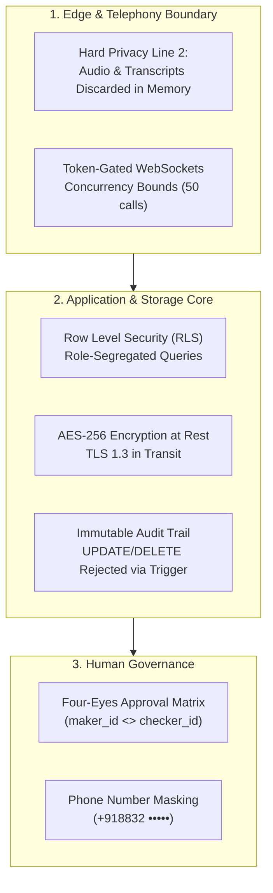

# BloodNorms — Technical & Organizational Privacy Controls (PRIVACY_CONTROLS.md)

**Role:** Chief Privacy & Security Architect  
**Legal Framework:** Digital Personal Data Protection Act (DPDP Act) 2023  
**Status:** Enforced  
**Version:** 1.0.0

---

## 1. Technical & Organizational Measures (TOMs)

---

## 2. Core Privacy Guarantees

### 2.1 Principle of Data Minimization
- The system requests only the donor's blood group, rough radius/city, and masked telephone number.
- Geolocation is blurred to a distance band (e.g. "Within 3 km") on public screens to prevent stalking or physical tracing of donors.

### 2.2 Donor Health Question Anonymization (Hard Privacy Line 1)
- Medical eligibility questions (e.g. weight, recent tattoos, illness) are evaluated **client-side or ephemeral in-memory only**.
- The database schema completely lacks any column or table storing donor questionnaire answers.
- Admin consoles are physically incapable of inspecting or querying private donor health responses.

### 2.3 Ephemeral Audio Streaming (Hard Privacy Line 2)
- Telephony media streams from Twilio are routed directly into the Google Gemini Live API over encrypted WebSocket connections.
- Raw PCM/µ-law audio buffers exist only in ephemeral process memory for the duration of the packet transmission.
- Zero audio chunks, recording files, or speech-to-text transcripts are saved to PostgreSQL, Redis, Cloud Storage, or disk.

### 2.4 Four-Eyes Governance on Sensitive Exports
- Any administrative operation attempting to export unmasked donor data (Tier 3) or dispatch broadcasts to > 200 donors requires a dual-authorization token (`maker_id != checker_id`) signed by two distinct verified administrators.
