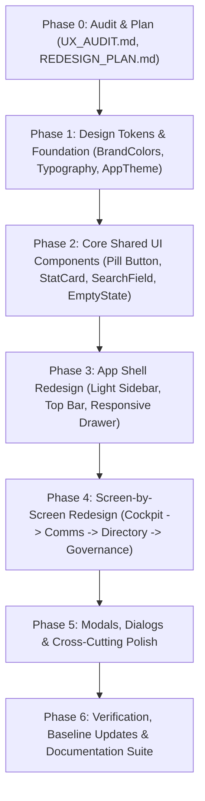

# BloodNorms — Admin Redesign Execution Plan (REDESIGN_PLAN.md)

**Role:** Principal Product Designer & Senior Frontend Engineer  
**Date:** November 2026  
**Status:** In Execution  

---

## 1. Phasing & Execution Roadmap

---

## 2. Detailed Work Breakdown

### Step 1: Design Tokens & Typography Foundation
- Update `lib/shared/theme/brand_colors.dart` with the calm, light Stitch-inspired palette:
  - Page Background: `#FFFFFF`
  - Soft Surface: `#F8F9FA`
  - Muted Surface: `#F1F3F4`
  - Subtle Border: `#E8EAED`
  - Strong Border: `#DADCE0`
  - Text Primary: `#202124`
  - Text Secondary: `#5F6368`
  - Primary Action Pill: `#1F1F1F` with white text
  - Accent: `#5B5BF0` with soft tint `#EEF0FF`
  - Status tokens: Success (`#1E8E3E`, tint `#E6F4EA`), Warning (`#B06000`, tint `#FEF7E0`), Error (`#D93025`, tint `#FCE8E6`).
  - Radius tokens: `radiusPill = 999.0`, `radiusCard = 16.0`, `radiusInput = 12.0`, `radiusDialog = 24.0`.
- Update `lib/shared/theme/brand_typography.dart` to adhere to the geometric sans hierarchy:
  - Display 40, Headline 28, Title 20, Body Large 16, Body 14 (default), Label 12. Sentence case everywhere.
- Update `lib/shared/theme/app_theme.dart` forcing pure light theme (`brightness: Brightness.light`), removing dark mode variants.

### Step 2: Shared UI Components
Create or update tactile, accessible components in `lib/shared/widgets/`:
1. `AppPillButton`: Primary near-black pill, secondary outlined pill, tonal accent pill, minimum height 44px with micro-animation press feedback.
2. `AppStatCard`: Soft 16px card with large headline number, quiet label, and subtle icon.
3. `AppSearchField`: Fully rounded pill search input with thin outline search icon and clear button.
4. `AppSegmentedControl`: Sliding pill segmented picker for binary/ternary toggles.
5. `AppPageHeader`: Standard view header with title, one-line friendly description, and single primary action button top-right.
6. `AppEmptyState`: Soft-tinted circle with thin outline icon, friendly 1-sentence explanation, and prominent action pill.
7. `AppErrorState`: Clear error description, helpful guidance, and retry pill button.

### Step 3: App Shell Redesign (`AdminSidebar`, `AdminHeader`, `AdminConsoleScreen`)
- Replace the dark `#121316` sidebar with a calm `#F8F9FA` surface with 1px `#E8EAED` border.
- Active navigation item rendered as a soft `#EEF0FF` tint pill with `#5B5BF0` text and filled icon.
- Replace top bar with a clean `#FFFFFF` bar with page breadcrumb and quick action pills.

### Step 4: Screen-by-Screen Redesign
Refactor views sequentially with Conventional Commits, verifying each view:
- **Group A (Cockpit & Emergency Response):**
  - `dashboard_cockpit_view.dart` & `cockpit_kpi_cards_row.dart`
  - `crisis_radar_view.dart`
  - `needs_human_view.dart`
- **Group B (Communications & Broadcast Desk):**
  - `broadcast_dispatch_view.dart` & `broadcast_audience_summary_banner.dart`
  - `broadcast_audience_view.dart`
  - `broadcast_history_view.dart`
  - `whatsapp_bot_view.dart`, `whatsapp_templates_view.dart`, `whatsapp_telecom_view.dart`
  - `voice_prompts_view.dart`, `voice_simulator_view.dart`, `voice_safety_view.dart`
- **Group C (Directory & Healthcare Desks):**
  - `blood_camps_admin_view.dart`
  - `blood_banks_stock_view.dart`
  - `donors_registry_view.dart`
  - `hospitals_registry_view.dart`
  - `requester_shield_view.dart`
  - `community_partners_view.dart`
- **Group D (Governance & Security Desks):**
  - `approvals_queue_view.dart`
  - `data_exports_view.dart`
  - `dpdp_registry_view.dart`
  - `killswitch_settings_view.dart`
  - `safety_desk_view.dart`
  - `algorithm_settings_view.dart`
  - `audit_logs_view.dart`

### Step 5: Modals, Dialogs, and Polish
- Restyle `admin_four_eyes_dialog.dart` and `quick_actions_sheet.dart` with 24px soft rounded corners, light surfaces, and clear primary/cancel buttons.
- Standardize toasts to float bottom-center in near-black `#1F1F1F` pill format.

### Step 6: Verification & Documentation Suite
- Verify line limits: all files <= 200 lines.
- Run `flutter analyze` and `flutter test`.
- Author documentation suite:
  - `docs/design/DESIGN_SYSTEM.md`
  - `DESIGN.md` (root agent guide)
  - `docs/design/COMPONENTS.md`
  - `docs/design/UX_PRINCIPLES.md`
  - `docs/design/ADDING_A_NEW_SCREEN.md`
  - Update `AGENTS.md` with "UI and UX rules for agents".
  - Author `docs/design/FINAL_REPORT.md`.

---

## 3. Risks & Mitigations

| Risk | Severity | Mitigation Strategy |
|---|---|---|
| Business logic altered during widget refactor | Critical | Zero logic change rule: keep all state bindings, controllers, callbacks, and data structures 100% identical. |
| Files exceed 200 lines after adding UI structure | High | Target 50–150 lines per file; extract sub-widgets into dedicated files immediately. |
| Contrast failure on light surfaces | High | All text tokens strictly tested for WCAG 2.1 AA compliance (>= 4.5:1 for body, >= 3:1 for UI elements). |
| Existing automated tests break | High | Preserve all `data-testid` keys and widget types; run test suite after every step. |

