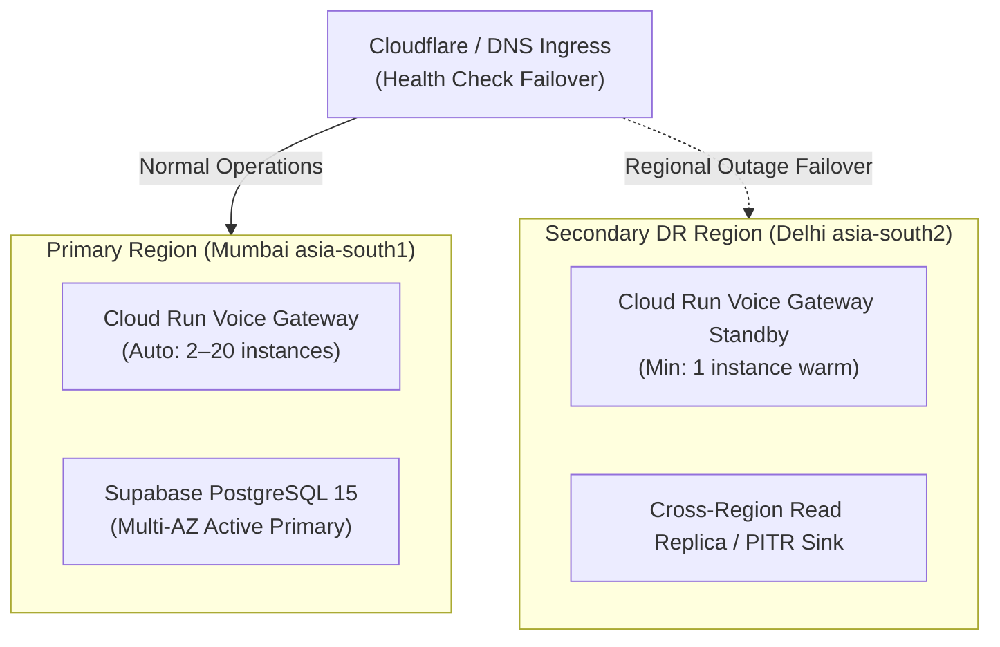

# BloodNorms — Disaster Recovery & Continuity Plan (DISASTER_RECOVERY.md)

**Role:** Principal Disaster Recovery & Resilience Architect  
**Targets:** RPO <= 15 minutes; RTO <= 60 minutes  
**Primary Region:** `asia-south1` (Mumbai)  
**Secondary DR Region:** `asia-south2` (Delhi)  
**Version:** 1.0.0

---

## 1. Disaster Recovery Topology

---

## 2. Disaster Recovery Scenarios & Playbooks

### Scenario A: Cloud Run Voice Gateway Regional Outage
- **Detection:** Synthetic health monitor in Delhi reports 3 consecutive `/healthz` timeouts on Mumbai endpoint.
- **Failover:**
  1. DNS health check automatically flips `voice.bloodnorms.org` to Delhi Cloud Run ingress.
  2. Twilio WebSocket media streams reconnect to Delhi within 15 seconds.
  3. RTO: < 2 minutes. RPO: 0 seconds (stateless stream).

### Scenario B: Primary Database Region Catastrophe
- **Detection:** Supabase management plane declares regional infrastructure loss.
- **Failover:**
  1. Activate Secondary Standby in Delhi using Point-in-Time Recovery (PITR) to latest WAL checkpoint.
  2. Repoint `SUPABASE_URL` in Cloud Run secret environment variables.
  3. Trigger automated integrity gate: verify `trg_audit_logs_immutable` and row counts.
  4. RTO: < 45 minutes. RPO: < 15 minutes.

---

## 3. Annual DR Simulation Drills

- **Schedule:** Bi-annual (every 6 months) unannounced tabletop and live simulation drill.
- **Verification Gates:**
  1. Verify zero data loss on completed emergency matches.
  2. Verify no donor health answers exist in backups.
  3. Verify Twilio callers successfully reach Sulafat voice assistant on failover instance.
