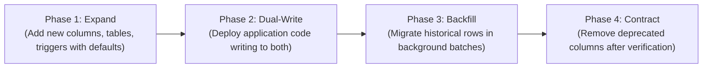

# BloodNorms — Database Migration Rules & Safety Guide (MIGRATION_RULES.md)

**Role:** Principal Database Reliability Engineer  
**Scope:** PostgreSQL 15 + PostGIS (Supabase Managed Engine)  
**Version:** 1.0.0

---

## 1. The Core Philosophy: Zero-Downtime, Forward-Compatible

BloodNorms handles life-and-death medical emergencies. The database cannot be taken offline for maintenance windows or migrations. Every schema migration must support **zero-downtime rolling deployments** where servers running old code and new code operate against the database concurrently.

---

## 2. Hard Invariants for Migrations

1. **Sequential Naming:** Migrations live in `supabase/migrations/` and must follow strict 4-digit sequential prefixing: `0018_name.sql`, `0019_name.sql`.
2. **Idempotent Execution:** Every statement must be safely re-runnable without failing:
   - `create table if not exists ...`
   - `alter table ... add column if not exists ...`
   - `create index if not exists ...`
   - `create or replace function ...`
3. **Lock Minimization:**
   - In production migrations, set a strict lock timeout: `set lock_timeout = '3s';`.
   - Never run unbounded full-table updates in an exclusive migration transaction.
   - New indexes on large tables must use `create index concurrently`.
4. **No Destructive Operations:**
   - NEVER drop a table or column in a migration without a documented 30-day deprecation cycle.
   - Column renames are banned; add a new column, dual-write, and deprecate the old.
5. **Immutable Audit Integrity:**
   - No migration may ever disable or drop `trg_audit_logs_immutable`.

---

## 3. Migration Review Checklist

Before opening a PR that contains a migration:
- [ ] Migration filename matches `00XX_<domain_description>.sql`.
- [ ] Schema additions are purely additive (no removed columns, no changed types).
- [ ] All new foreign keys include index coverage to prevent table-level share locks.
- [ ] RLS policies are explicitly defined (`alter table ... enable row level security;`).
- [ ] `flutter test` and CI database linting pass.
