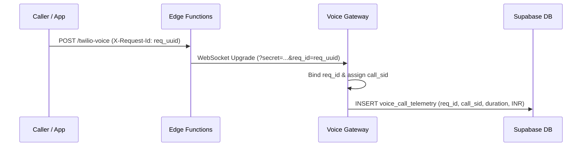

# BloodNorms — Observability & Distributed Tracing Specification (OBSERVABILITY.md)

**Role:** Staff Observability Architect  
**Scope:** Flutter Web/Mobile, Cloud Run Voice Gateway, Edge Functions, PostgreSQL  
**Version:** 1.0.0

---

## 1. Distributed Correlation IDs

In emergency blood matching, a single inbound helpline call triggers multiple asynchronous events: telephony webhooks, WebSocket media streams, Gemini Live sessions, spatial search queries, and WhatsApp template dispatches.

To enable end-to-end trace correlation without exposing PII, every request is stamped with two immutable identifiers:



### Propagation Standards:
- **`X-Request-Id`:** UUIDv4 generated at the ingress edge. Returned in HTTP response headers and attached to every structured log entry.
- **`call_sid` / `stream_sid`:** Twilio telephony identifier, propagated through WebSocket frames and DB telemetry.
- **Log Binding:** Every log entry in Voice Gateway includes `{ reqId, streamSid }` in the JSON metadata.

---

## 2. Structured JSON Logging & PII Redaction

### 2.1 Technical Requirements
All logs must be emitted as single-line JSON to `stdout` to support Google Cloud Logging, Datadog, or Grafana Loki ingestion.

### 2.2 Hard Privacy Redaction (DPDP Act Compliance)
Per Hard Privacy Lines 1 & 2 in `AGENTS.md`:
1. **Donor Medical Responses:** Never queried, never serialized in debug statements.
2. **Audio & Transcripts:** `payload`, `data`, `audio`, and `transcript` keys are redacted automatically at the logger root via Pino redact paths:
   ```typescript
   redact: ["payload", "data", "audio", "transcript", "token", "secret", "password"]
   ```
3. **Phone Numbers:** When logging phone numbers for telemetry, mask the last 5 digits (`+918832 •••••`).

---

## 3. Error Tracking & Boundaries (Sentry-Ready)

### 3.1 Node.js Voice Gateway
Unhandled exceptions and unhandled promise rejections are intercepted globally:
```typescript
process.on("unhandledRejection", (reason) => {
  logger.error({ reason }, "[Fatal] Unhandled Promise Rejection");
});
```

### 3.2 Flutter Client Error Reporter
Errors are captured via Flutter's `FlutterError.onError` and `PlatformDispatcher.instance.onError`, stripping any sensitive text before dispatch to external logging sinks.

---

## 4. Audit Log Immutability & Verification

The `audit_logs` table stores administrative events (maintenance toggles, rate card updates, data exports).
- Trigger `trg_audit_logs_immutable` executes `BEFORE UPDATE OR DELETE`, raising an exception `RAISE EXCEPTION 'Audit log entries are immutable'`.
- Verified by automated regression tests in `test/database_rls_matrix_test.dart`.
