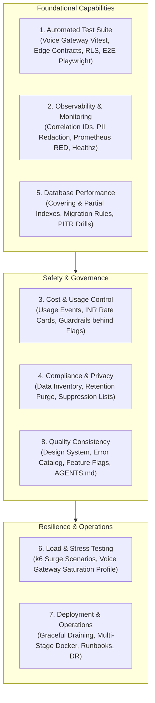

# BloodNorms — Reliability, Quality, and Operations Plan (PLAN.md)

**Role:** Staff Reliability & Operations Engineer  
**Date:** November 2026  
**Status:** In Execution  
**Project:** BloodNorms Emergency Blood-Donation Platform  

---

## 1. Executive Summary & Recorded Baseline

BloodNorms has completed its architectural restructuring (Part A) and security hardening (Part B). The system currently satisfies all architectural constraints:
- **Zero Line-Limit Violations:** All 267 Dart files in `lib/` are under 200 lines (target: 50–150 lines).
- **Strict Client-Server Isolation:** Zero server secrets in client assets (`assets/.env.example` verified).
- **Hard Privacy Compliance:** DPDP Act protections (no health questions in admin queries, no audio/transcript storage, immutable audit log trigger).

### Recorded Engineering Baseline (Pre-Operations)
| Gate | Command | Baseline Result | Status |
|---|---|---|---|
| **Flutter Tests** | `flutter test` | **77/77 tests passed** (11.0s across 13 test suites) | **GREEN** |
| **Flutter Analyze** | `flutter analyze` | **0 errors, 0 warnings** (140 informational style lints) | **GREEN** |
| **Voice Gateway Build** | `cd voice-gateway && npm run build` | **`tsc` exits with code 0** (clean compilation) | **GREEN** |
| **File Size Limit** | `lib/**/*.dart` | **0 files > 200 lines** | **GREEN** |
| **Database Migrations** | `supabase/migrations/` | **17 sequential migrations** (`0001` to `0017`) | **GREEN** |

---

## 2. Scope & Capability Roadmap

To make BloodNorms safe to scale to millions of donors and thousands of concurrent emergency requests across India, we are engineering eight comprehensive operational capabilities.



---

## 3. Capability Breakdown & Gap Analysis

### 3.1 Capability 1: Automated Test Suite
- **Current State:** Flutter test suite has 77 tests covering domain models, ring calculations, encryption, CSV sanitization, and four-eyes governance. Voice Gateway has zero automated tests. Edge Functions have no automated contract checks. No browser-level E2E tests exist.
- **Planned Additions:**
  1. `voice-gateway/tests/`: Unit and integration test suite using Node test runner / Vitest testing WebSocket upgrades, authentication verification, concurrency limit (50 calls), payload limit (64 KB), and CallSession state transitions using a mock speech provider.
  2. `test/edge_functions_contract_test.dart`: Automated contract testing of Edge Function payloads (`engine-tick`, `twilio-voice`, `whatsapp-webhook`).
  3. `test/database_rls_matrix_test.dart`: Automated table-driven RLS permission verification matrix.
  4. `tests/e2e/`: Playwright E2E browser test configuration with Page Object Models, semantic selectors, accessibility auditing (axe-core), and visual regression baseline.
  5. Mutation sanity check: Intentionally introduce mutations in critical state transitions and cost math to verify test sensitivity, documenting outcomes in `docs/testing/STRATEGY.md`.
  6. Documentation: `docs/testing/STRATEGY.md` and `docs/testing/HOW_TO_WRITE_TESTS.md`.
  7. CI/CD update: Update `.github/workflows/ci.yml` with all new gates.

### 3.2 Capability 2: Observability and Monitoring
- **Current State:** Basic Pino logger in Voice Gateway; basic audit log table in PostgreSQL. No correlation ID propagation, no Prometheus metrics endpoint, no liveness/readiness probes, no alerts as code.
- **Planned Additions:**
  1. Distributed Correlation IDs: Generate and propagate `x-request-id` and `x-call-id` across HTTP headers, WebSocket messages, and DB telemetry logs.
  2. PII-Safe Structured Logger: Enhance `logger.ts` to redact phone numbers (`\+91\d{10}`), Bearer tokens, passwords, and speech transcript fragments. Add automated redaction tests.
  3. Prometheus Metrics: Expose `/metrics` on Voice Gateway with RED metrics: `voice_calls_active`, `voice_call_duration_seconds`, `voice_gateway_errors_total`, `http_request_duration_seconds`.
  4. Health Endpoints: Implement standard Kubernetes probes: `/livez` (process liveness), `/readyz` (dependency readiness), and sanitized `/health`.
  5. Alerts as Code: `docs/operations/ALERTS.md` documenting Prometheus alerting rules (P1/P2 thresholds, notification targets, runbook links).
  6. Declarative Dashboards: `docs/operations/dashboards/grafana.json` containing ready-to-import Grafana dashboard.
  7. Sentry Error Hooks: Centralized error handling interface for Flutter web client and Node services.
  8. Documentation: `docs/operations/OBSERVABILITY.md` and `docs/operations/METRICS.md`.

### 3.3 Capability 3: Cost and Usage Control
- **Current State:** Flutter `AdminCostService` computes theoretical costs using hardcoded rate approximations. No persistent event log for API consumption.
- **Planned Additions:**
  1. Migration `0018_usage_events_and_cost_guardrails.sql`: Create `usage_events` table (service, units, estimated_cost_inr, request_id, tenant_id, timestamp) with indexing and immutable protection.
  2. Pricing Configuration: `config/pricing_rates.json` specifying versioned rates in INR (Meta WhatsApp conversations, Twilio call minutes, Gemini Live audio minutes).
  3. Cost & Safety Guardrails: Voice Gateway max duration limiter (default 10 mins), spending rate limiter, and global emergency killswitch, all guarded by **feature flags defaulting to OFF**.
  4. Cost Calculation Service: Server/gateway cost calculator respecting versioned rate cards.
  5. Documentation: `docs/operations/COST_CONTROL.md`.

### 3.4 Capability 4: Compliance and Privacy (DPDP Act)
- **Current State:** Privacy guidelines established in `AGENTS.md` and `docs/decisions/005-hard-privacy-lines.md`. Lacks formal data inventory, retention automation, and data subject rights procedures.
- **Planned Additions:**
  1. `docs/compliance/DATA_INVENTORY.md`: Comprehensive data dictionary covering every entity, sensitivity class (PII, Sensitive PII, Operational), legal basis, and retention duration.
  2. `docs/compliance/PRIVACY_CONTROLS.md`: Technical and organizational measures for DPDP Act 2023 compliance.
  3. `docs/compliance/RETENTION_POLICY_DRAFT.md`: Retention schedules and automated disposal definitions.
  4. Migration `0019_retention_and_suppression.sql`: Automated data purge routine for expired temporary records and creation of `suppression_list` table for Do-Not-Disturb / donor opt-outs.
  5. `docs/compliance/DATA_SUBJECT_REQUESTS.md`: Step-by-step procedure for handling DPDP Act Section 11/12 rights (access, rectification, erasure).
  6. `docs/compliance/LEGAL_REVIEW_QUESTIONS.md`: Questions requiring legal counsel resolution prior to national rollout.

### 3.5 Capability 5: Database Performance and Reliability
- **Current State:** 17 migrations define baseline tables and foreign keys. Lacks targeted covering and partial indexes for high-frequency filters (active requests, pending approvals, recent audit logs).
- **Planned Additions:**
  1. Migration `0020_performance_indexes.sql`: Add indexes on `audit_logs(created_at DESC)`, `blood_requests(status) WHERE status = 'active'`, `blood_bank_stock(bank_id, blood_group)`, and `voice_call_telemetry(created_at DESC)`.
  2. Migration Rules: `docs/operations/MIGRATION_RULES.md` documenting zero-downtime rules (concurrent index creation, lock timeouts, column addition safety).
  3. Backup & Recovery Runbook: `docs/operations/BACKUP_AND_RESTORE.md` detailing point-in-time recovery (PITR) procedures, RTO/RPO targets, and restoration verification drills.

### 3.6 Capability 6: Load and Stress Testing
- **Current State:** No automated load generation tools or capacity benchmarks.
- **Planned Additions:**
  1. Load Test Harness in `tests/load/`: Modular k6 / Node load-testing scripts simulating 10, 50, and 200 concurrent WebSocket calls, burst webhook events, and emergency donor searches.
  2. Mock Providers: Mock Gemini Live WebSocket server and mock Twilio media streamer to test without third-party network costs or quota limits.
  3. Capacity Report: `docs/operations/CAPACITY_REPORT.md` documenting throughput ceilings, connection degradation points, memory growth under load, and scaling thresholds.

### 3.7 Capability 7: Deployment and Operations
- **Current State:** Standalone Dockerfile for Voice Gateway. No multi-service compose environment, no formal environment documentation, no disaster recovery specification, no runbooks.
- **Planned Additions:**
  1. Environments Guide: `docs/operations/ENVIRONMENTS.md` documenting local, staging, and production topologies and secret stores.
  2. Root `docker-compose.yml`: Reproducible local operations environment running Voice Gateway, mock services, and PostgreSQL.
  3. Zero-Downtime Draining: Add SIGTERM / SIGINT graceful shutdown in Voice Gateway that stops accepting new connections and permits active calls up to 30 seconds to terminate cleanly.
  4. Incident Runbooks: `docs/operations/runbooks/` with 5 targeted runbooks:
     - `voice_gateway_outage.md`
     - `database_failover.md`
     - `high_latency_gemini.md`
     - `telephony_quota_exhausted.md`
     - `fraud_alert_burst.md`
  5. Disaster Recovery: `docs/operations/DISASTER_RECOVERY.md` with regional failover, backup verification, and communication plans.
  6. Infrastructure Manifests: Cloud Run / Terraform templates in `infra/` for reproducible deployment.

### 3.8 Capability 8: Product Quality Consistency
- **Current State:** Colors and typography defined in Flutter; no standalone design system documentation; permissions partially scattered across mixins; error messages scattered across views.
- **Planned Additions:**
  1. Design System: `docs/design/DESIGN_SYSTEM.md` detailing the tactile design system, typography tokens, color roles, spacing scales, and accessibility rules.
  2. Permissions & RBAC: `docs/security/ROLES_AND_PERMISSIONS.md` detailing exact privileges for Requester, Donor, Bank Staff, Admin, and SuperAdmin.
  3. Centralized Error Catalog: `lib/shared/constants/app_error_catalog.dart` providing typed, localized error codes and user-safe recovery messages.
  4. Feature Flags Specification: `docs/operations/FEATURE_FLAGS.md` describing all feature flags, their scopes, defaults (all OFF), and safety rules.
  5. AGENTS.md Update: Add Section 6 ("Operations Rules for Agents") ensuring future engineers and AI agents adhere to operations, telemetry, and privacy standards.

---

## 4. Quality Gates & Phased Verification Strategy

Every phase must satisfy all quality gates before committing:
```bash
# Gate 1: Flutter code analysis
flutter analyze

# Gate 2: Flutter test execution
flutter test

# Gate 3: Voice Gateway compilation & tests
cd voice-gateway && npm run build && npm test
```

### Risk Assessment & Mitigation
| Risk | Severity | Mitigation Strategy |
|---|---|---|
| New guardrails accidentally alter production behavior | High | All guardrails (spending caps, call limits) sit behind feature flags defaulting strictly to **OFF**. |
| New dependencies bloat bundle or break builds | Medium | Use zero heavy runtime dependencies; utilize Node native test runner / lightweight test harness; no major version upgrades. |
| Files exceed 200-line architectural constraint | High | Maintain target of 50–150 lines per file; modularize components and services across dedicated files. |
| Secrets leak in test scripts or docker configs | Critical | Use sandbox/dummy credentials (`test_secret`, `http://localhost:8080`) only; verify `.gitignore`. |

---

## 5. Sign-Off & Execution Order

1. **Phase 1:** Automated Test Suite (Gateway tests, Edge contracts, RLS tests, Playwright setup, testing docs, CI).
2. **Phase 2:** Observability & Monitoring (Correlation IDs, PII redaction, Prometheus metrics, healthz, alerts, dashboards).
3. **Phase 5:** Database Performance & Reliability (Migrations 0018-0020, migration rules, backup runbook).
4. **Phase 3 & 4:** Cost Control & DPDP Compliance (Pricing rates, guardrails, data inventory, privacy controls, retention).
5. **Phase 6:** Load & Stress Testing (Harness, scenarios, capacity report).
6. **Phase 7 & 8:** Deployment, Operations & Product Quality (Docker compose, runbooks, design system, error catalog, AGENTS.md update).
7. **Final Verification & Report:** Complete quality gate verification and author `docs/operations/FINAL_REPORT.md`.
