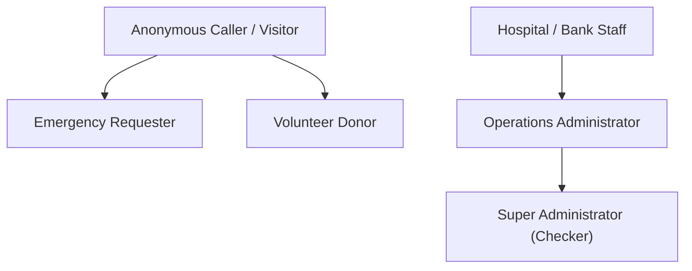

# BloodNorms — Roles, Privileges & RBAC Specification (ROLES_AND_PERMISSIONS.md)

**Role:** Principal Security & Governance Architect  
**Framework:** Centralized Role-Based Access Control (RBAC)  
**Version:** 1.0.0

---

## 1. Role Hierarchy & Governance Model

---

## 2. Complete Permissions Matrix

| Platform Capability | Anonymous | Requester | Donor | Bank Staff | Admin (Maker) | SuperAdmin (Checker) |
|---|---|---|---|---|---|---|
| **Dial Helpline / Keypad IVR** | **YES** | **YES** | **YES** | **YES** | **YES** | **YES** |
| **Create Emergency Request** | **YES** | **YES** | NO | NO | **YES** | **YES** |
| **View Active Match Rings** | NO | **YES** (Own) | NO | NO | **YES** | **YES** |
| **Update Personal Donor Status** | NO | NO | **YES** (Own) | NO | NO | NO |
| **Manage Hospital Blood Stock** | NO | NO | NO | **YES** (Own) | **YES** | **YES** |
| **Check-in Camp Attendees** | NO | NO | NO | **YES** | **YES** | **YES** |
| **View Admin Operations Cockpit** | NO | NO | NO | NO | **YES** | **YES** |
| **Broadcast to <= 200 Donors** | NO | NO | NO | NO | **YES** | **YES** |
| **Broadcast to > 200 Donors** | NO | NO | NO | NO | REQUEST (Maker)| **APPROVE (Checker)** |
| **Update Financial Rate Cards** | NO | NO | NO | NO | REQUEST (Maker)| **APPROVE (Checker)** |
| **Export Tier 2 Data (Masked)** | NO | NO | NO | NO | **YES** | **YES** |
| **Export Tier 3 Data (Unmasked)**| NO | NO | NO | NO | REQUEST (Maker)| **APPROVE (Checker)** |
| **Toggle Emergency Killswitch** | NO | NO | NO | NO | **YES** | **YES** |
| **View Raw Donor Health Answers**| **DENIED** | **DENIED** | **DENIED** | **DENIED** | **DENIED** | **DENIED (Hard Privacy)** |

---

## 3. Four-Eyes Governance Rules (Maker-Checker Separation)

For any high-impact mutation (Broadcast > 200, Rate Cards, Tier 3 Export):
1. **Maker Separation:** The administrator initiating the action (`maker_id`) CANNOT approve their own action (`checker_id <> maker_id`).
2. **Time-Limited Token:** Approval requests expire after 24 hours.
3. **Step-Up Verification:** Checker must enter a 6-digit numeric TOTP token.
4. **Immutable Log:** Approval events are permanently written to `audit_logs`.
