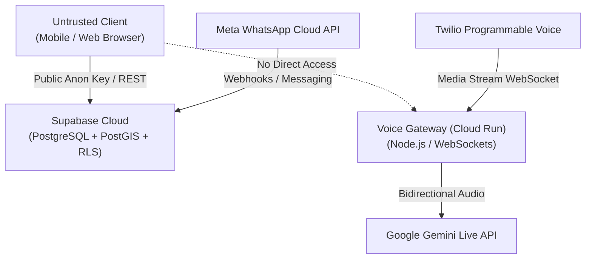

# BloodNorms — Threat Model & Security Architecture

**Version:** 2.0.0  
**Compliance Standard:** India Digital Personal Data Protection (DPDP) Act 2023  
**Classification:** Restricted Engineering Documentation

---

## 1. System Architecture & Boundaries

### Trust Zones
1. **Zone 0 (Completely Untrusted):** Client device runtime, browser DOM, mobile APK/IPA storage, public network.
2. **Zone 1 (Semi-Trusted Ingest):** Telephony carrier webhooks (Twilio, Meta Graph API). Protected with signature verification and webhook verify tokens.
3. **Zone 2 (Controlled Microservice):** Voice Gateway on Cloud Run. Ephemeral media pipelines, zero database access, authenticated WebSockets.
4. **Zone 3 (Core Trusted Backend):** Supabase PostgreSQL database, PostGIS spatial engine, and Deno edge functions. Row-Level Security (RLS) and immutable triggers strictly enforce authorization.

---

## 2. Threat Actors & Attack Vectors

| Actor | Profile & Motivation | Targeted Assets | Mitigations in Place |
|---|---|---|---|
| **External Attacker** | Opportunistic reconnaissance, credential scraping from public APK bundles | Service role keys, JWT secrets, database credentials | Client bundle stripped of server secrets; `.env` strictly untracked; RLS enabled on all tables. |
| **Malicious Donor / Requester** | Spam requests, denial of service, GPS location spoofing, harassment calls | Emergency dispatch bandwidth, donor phone numbers | Rate limiting, abuse scoring on requester profiles, distance band masking. |
| **Rogue / Compromised Admin** | Mass broadcast spam, unauthorized data exfiltration, audit trail tampering | Donor PII, regional donor broadcast channel, audit logs | Four-Eyes governance (`maker_id <> checker_id`); immutable audit logs rejecting `UPDATE`/`DELETE`. |
| **Formula Injection (Spreadsheet)** | Malicious payloads in names/addresses executed when admin opens CSV export in Excel | Admin workstation shell via DDE / formula execution (`=CMD`) | Automated sanitization prepending `'` to `=`, `+`, `-`, `@` across all CSV export routines. |

---

## 3. STRIDE Threat Analysis

### Spoofing (Identity)
- **Threat:** Callers impersonating emergency requesters or donors.
- **Mitigation:** Inbound IVR verifies caller ID against active requests; OTP step-up verification required for sensitive profile modifications.

### Tampering (Data Integrity)
- **Threat:** Tampering with audit logs to conceal unauthorized mass broadcasts or stock adjustments.
- **Mitigation:** PostgreSQL database trigger `reject_audit_tampering` unconditionally aborts any `UPDATE` or `DELETE` on `audit_logs` with SQLSTATE `42501`.

### Repudiation
- **Threat:** Administrators denying executing mass broadcasts or rate-card changes.
- **Mitigation:** Immutable audit ledger logs user UUID, timestamp, action type, IP address, and JSON diff payload for every state mutation.

### Information Disclosure (Privacy Violation)
- **Threat:** Donor health answers leaked to administrative staff or exported via reporting.
- **Mitigation:** Pre-donation medical questionnaire answers are stored in an encrypted vault and strictly excluded from all admin views, API select clauses, and export routines (Hard Privacy Line 1).

### Denial of Service
- **Threat:** WebSocket connection flooding against the Voice Gateway.
- **Mitigation:** Max concurrency cap of 50 simultaneous active calls; max payload size enforcement (64 KB); token authentication on WebSocket upgrade.

### Elevation of Privilege
- **Threat:** Standard administrator executing Tier 3 identifiable data exports or broadcasts > 200 donors single-handedly.
- **Mitigation:** Four-Eyes approval matrix enforced at both service layer and database RPC layer. Requests cannot be self-approved (`maker_id != checker_id`).
