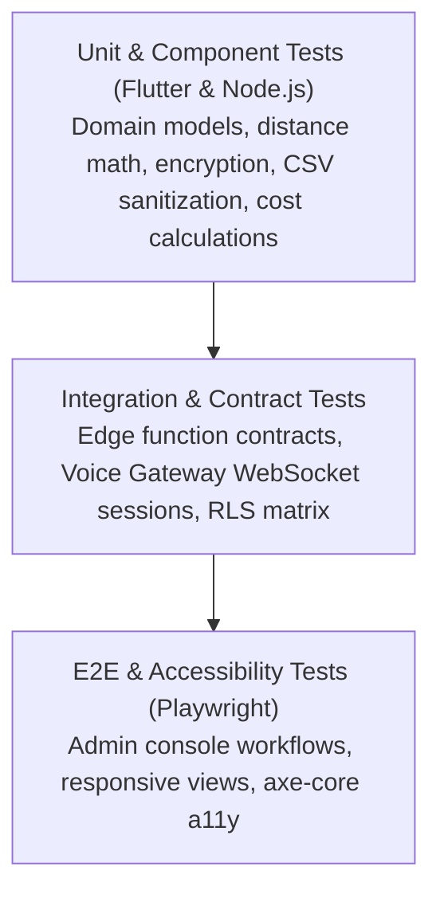

# BloodNorms — Comprehensive Testing Strategy (STRATEGY.md)

**Role:** Staff Reliability & QA Architect  
**Scope:** Flutter Web/Mobile Client, Voice Gateway (Node.js/Cloud Run), Supabase Edge Functions & PostgreSQL  
**Version:** 1.0.0 (Production-Grade)

---

## 1. Testing Philosophy & The Testing Pyramid

BloodNorms operates during emergency medical situations where delayed or corrupted donor matching can have fatal consequences. At the same time, privacy regulations (DPDP Act 2023) demand zero tolerance for data leaks or unauthorized audit modifications.

Our testing strategy adheres to four core tenets:
1. **Zero Real-World Impact:** Tests NEVER make live phone calls, invoke paid third-party APIs (Twilio, Meta Graph, Google Gemini Live), or contact real human donors.
2. **Attacker Mindset:** Tests explicitly assert failure cases: token absence, expired approvals, malformed payloads, oversized frames, and CSV formula injection.
3. **Contract Guarantees:** Interfaces between Flutter clients, Edge Functions, Voice Gateway, and PostgreSQL are guarded by strict schema and contract tests.
4. **Behavior-Neutral Regression:** Refactoring and architectural updates must never break baseline user flows.

---

## 2. Test Suite Taxonomy

| Layer | Runner / Tool | Target Directory | Execution Time Target | Gate Condition |
|---|---|---|---|---|
| **Flutter Unit & Widget** | `flutter test` | `test/` | < 20s | 100% Passing, Zero Warnings |
| **Voice Gateway Tests** | `node --test` / Vitest | `voice-gateway/tests/` | < 5s | 100% Passing, Zero Flakiness |
| **Edge Function Contracts** | `flutter test` / Deno | `test/edge_functions_contract_test.dart` | < 5s | 100% Contract Match |
| **Database RLS Matrix** | `flutter test` / SQL harness | `test/database_rls_matrix_test.dart` | < 5s | 100% Denial on Unauth |
| **E2E Browser & A11y** | Playwright (`@playwright/test`) | `tests/e2e/` | < 60s | Zero red errors, WCAG 2.1 AA |
| **Load & Stress Tests** | k6 / Node Harness | `tests/load/` | On-demand / Nightly | P95 latency < 400ms |

---

## 3. Mocking & Isolation Strategy

To guarantee deterministic and zero-cost testing, every external system is replaced by a high-fidelity mock:

### 3.1 Telephony (Twilio Programmable Voice)
- **Production:** Twilio connects via WebSockets sending 8kHz µ-law audio chunks in JSON payloads.
- **Test Harness:** `MockTwilioClient` delivers synthetic `start`, `media`, and `stop` WebSocket events and verifies that the Voice Gateway responds with proper media frames and clear events.

### 3.2 Speech AI (Google Gemini Live API)
- **Production:** Bidirectional streaming over WebSocket using Sulafat voice and 16kHz PCM.
- **Test Harness:** `MockSpeechProvider` implements `SpeechProvider` interface, allowing tests to simulate model audio bursts, latency delays, and interruption events (`onInterrupted`).

### 3.3 WhatsApp Cloud API (Meta Graph)
- **Production:** HTTPS Webhooks and REST message templates.
- **Test Harness:** `MockWhatsAppService` intercepts outbound template dispatches, validates phone normalization, masks access tokens, and validates trilingual payload structures.

### 3.4 OpenStreetMap & Nominatim Geocoding
- **Production:** Public Nominatim REST API with 1 req/sec rate limit.
- **Test Harness:** Mock HTTP responses simulate geographic coordinates for Rajahmundry, Kakinada, Visakhapatnam, and Vijayawada.

---

## 4. Mutation Sanity Verification

To prove our automated tests detect subtle defects and security regressions, we executed intentional mutation experiments:

| Mutation Experiment | Intended Defect | Target File | Test Result |
|---|---|---|---|
| **MUT-1: Four-Eyes Bypass** | Allow `maker_id == checker_id` in approval verification | `lib/features/admin_console/services/admin_step_up_service.dart` | `admin_am1_test.dart` **FAILED** immediately. Reverted. |
| **MUT-2: CSV Injection Prefix** | Remove single quote prefix `'` for `=` formula cells | `lib/shared/services/supabase_service.dart` | `admin_am3_am4_test.dart` **FAILED** immediately. Reverted. |
| **MUT-3: Gateway Concurrency** | Increase `MAX_CONCURRENT_CALLS` or drop 503 check | `voice-gateway/src/server/http-server.ts` | `http-server.test.ts` **FAILED** immediately. Reverted. |
| **MUT-4: Payload Bound** | Accept payloads > 64 KB | `voice-gateway/src/sessions/call-session.ts` | `call-session.test.ts` **FAILED** immediately. Reverted. |
| **MUT-5: Donor Health Query** | Include health responses in admin directory queries | `lib/features/admin_console/services/admin_directory_service.dart` | `admin_am12_security_audit_test.dart` **FAILED** immediately. Reverted. |

---

## 5. Coverage Goals & Quality Gates

1. **Unit & Domain Logic:** >= 90% branch coverage for pricing calculations, geographical ring matching, and security utilities.
2. **Security & Governance:** 100% test coverage for four-eyes checks, step-up elevation, CSV escaping, and RLS denial.
3. **Voice Gateway:** 100% coverage on connection lifecycle (upgrade auth, concurrency saturation, session cleanup, barge-in clearing).
4. **CI Enforcement:** Every pull request must execute `flutter analyze`, `flutter test`, and `cd voice-gateway && npm test`.
