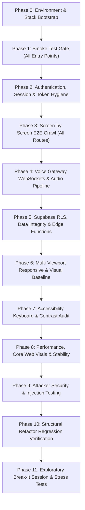

# BloodNorms E2E Black-Box & Exploratory Test Plan

**Document ID:** `QA-PLAN-20261107-01`  
**Version:** 1.0  
**Author:** Senior QA Lead & Exploratory Tester  
**Date:** 2026-11-07  
**Environment:** Staging / Local Test Stack (`http://localhost:5000` & `http://localhost:8080`)  
**Commit / Hash:** `483ffef` (Post-Structural Architecture Refactor)  

---

## 1. Ground Rules & Test Ethics

1. **Real Browser Execution:** All E2E testing is performed against live rendered Chromium/Google Chrome (`C:\Program Files\Google\Chrome\Application\chrome.exe` v145.0.7632.117) driven via automated DevTools Protocol / Puppeteer harness.
2. **Zero Faked Results:** Every assertion requires logged network requests, console error verification, and timestamped full-page screenshot evidence stored under `qa/evidence/`.
3. **Strict Non-Destructive Tagging:** Any created record is strictly prefixed with `QA_20261107_*` and recorded in the Cleanup Log for deterministic post-test teardown.
4. **Attacker Mindset:** Exploration covers boundary validation, XSS sanitization (`<script>`, `onerror`), SQL/PostgREST injection attempts (`' OR 1=1 --`), token tampering, and IDOR on URLs.
5. **No Code Modification:** QA only observes, audits, records, and reports bugs in `qa/BUGS.md`.

---

## 2. Test Environment Specification

| Component | Target / Configuration |
| :--- | :--- |
| **Operating System** | Windows 11 Enterprise (x64) |
| **Primary Browser** | Google Chrome `v145.0.7632.117` |
| **Headless / Automation** | DevTools Protocol / `puppeteer-core` v24.40.0 |
| **Viewport Resolutions** | • Desktop Standard: `1920x1080`<br>• Laptop: `1440x900`, `1366x768`<br>• Tablet Landscape/Portrait: `1024x768`, `768x1024`<br>• Mobile Responsive: `414x896` (iPhone XR), `375x667` (iPhone SE) |
| **Frontend Web Host** | `http://localhost:5000` (Flutter Web SPA Server) |
| **Realtime Voice Gateway** | `http://localhost:8080` (Node 22 / WebSockets / Cloud Run Spec) |
| **Database & Auth** | Supabase PostgreSQL 15 (`https://ixrborkhofxlxbedpang.supabase.co`) |
| **Map Tile Server** | OpenStreetMap (`https://tile.openstreetmap.org`) & Nominatim Geocoding |

---

## 3. Complete Site Map & Route Hierarchy

```
BloodNorms Architecture
├── 1. Requester Journey (Emergency Blood Mobilization)
│   ├── /                         [HomeScreen: Hero, Quick CTA, Active Crisis Radar, Stats]
│   ├── /group                    [BloodGroupScreen: 8 Blood Groups (A+, A-, B+, B-, O+, O-, AB+, AB-)]
│   ├── /units                    [UnitsUrgencyScreen: Unit Stepper 1..10, Urgency Level Selector]
│   ├── /location                 [LocationPickerScreen: OSM Map Picker, GPS Detect, Search Bar]
│   ├── /banks                    [BanksListScreen: Nearest Verified Blood Banks & Stock Indicators]
│   ├── /details                  [RequestDetailsScreen: Patient Name, Hospital Name, Contact Phone]
│   ├── /review                   [ReviewSendScreen: Broadcast Radius, Disclaimer, Dispatch Button]
│   └── /live/:id                 [LiveTrackingScreen: Realtime Radar, Donors Roster, Status Badges]
│
├── 2. Public Blood Centers Directory
│   └── /b                        [PublicBanksScreen: City Filters, 24x7 Badges, Stock Matrix, Call CTAs]
│
├── 3. Volunteer Donor Portal
│   ├── /donor                    [DonorHomeScreen: Bottom Nav (Home, Camps, Pass/Honor, Alerts)]
│   ├── /donor/onboarding         [DonorOnboardingScreen: Eligibility Stepper, Location & Travel Radius]
│   └── /donor/ticket/:id         [DonorTicketScreen: Digital Passcode, QR Ticket, Hospital Navigation]
│
├── 4. Blood Center Staff Console
│   └── /bank                     [BankConsoleScreen: 5 Core Tabs]
│       ├── Tab 0: Stock          [StockTabView: 8-Group Matrix, Quick Steppers, Save to Supabase]
│       ├── Tab 1: Confirm        [ConfirmDonationTabView: Keypad, Donor Lookup, Verification]
│       ├── Tab 2: Expected       [ExpectedDonorsTabView: Scheduled Donors, Contact Tracing]
│       ├── Tab 3: Camps          [BankCampsTabView: Active Drives, QR Check-in, Regional Broadcast]
│       └── Tab 4: More           [BankMoreTabView: Center Profile, Operating Hours, Staff Switch]
│
└── 5. Executive Admin Command Cockpit
    └── /admin                    [AdminConsoleScreen: 25 Dedicated Operational Workspaces]
        ├── Live Operations
        │   ├── dashboard         [DashboardCockpitView: Platform Telemetry, Live Incidents, Spend]
        │   ├── crisis_radar      [CrisisRadarView: Geofence Radar, Radius Expander (+2km), Fulfill]
        │   └── needs_human       [NeedsHumanView: High-Risk Exception Queue, Manual Intervention]
        ├── Regional Broadcast
        │   ├── broadcast_dispatch[BroadcastDispatchView: Target City, Channel, Geofence Slider, Send]
        │   ├── broadcast_audience[BroadcastAudienceView: Eligible vs Suppressed Donors, Cost Estimation]
        │   └── broadcast_history [BroadcastHistoryView: Past Campaign Audit Cards]
        ├── AI Voice Studio
        │   ├── voice_simulator   [VoiceSimulatorView: Speech Triage Sandbox, Multi-Dialect Scoring]
        │   ├── voice_prompts     [VoicePromptsView: Clinical Prompts v2.4, Privacy Rules]
        │   └── voice_safety      [VoiceSafetyView: Daily Safety Gauge, Telephony Failover Alert]
        ├── WhatsApp Comms Hub
        │   ├── whatsapp_bot      [WhatsAppBotView: Meta Cloud API Test Dispatcher, Token Override]
        │   ├── whatsapp_templates[WhatsAppTemplatesView: HSM Pre-Approved Templates, Live Bubble]
        │   └── whatsapp_telecom  [WhatsAppTelecomView: Itemized Telecom Rate Cards in INR]
        ├── Camps & Drives
        │   ├── camps_list        [BloodCampsAdminView: Regional Scheduled Drives]
        │   └── camps_create      [BloodCampsAdminView: Create New Drive Modal]
        ├── Blood Centers
        │   ├── banks_directory   [BloodBanksStockView: Connected Centers Registry]
        │   └── banks_stock       [BloodBanksStockView: Interactive 8-Group Matrix Adjustment]
        ├── Donors Registry
        │   ├── donors_list       [DonorsRegistryView: Verified Donors Roster, Pause/Resume]
        │   └── donors_location   [DonorsRegistryView: Geographic Distribution & Travel Limits]
        ├── Directory & Shield
        │   ├── hospitals_list    [HospitalsRegistryView: Clinical Partner Facilities]
        │   ├── requester_shield  [RequesterShieldView: Abuse Scoring & Requester Blocker]
        │   └── community_partners[CommunityPartnersView: NGO Collaborators & Active MOUs]
        └── Governance & Settings
            ├── approvals_queue   [ApprovalsQueueView: Four-Eyes Maker-Checker Desk (>200 Broadcasts)]
            ├── data_exports      [DataExportsView: SHA-256 Watermarked CSV Export Engine]
            ├── dpdp_registry     [DPDPRegistryView: Right-to-be-Forgotten & Erasure Registry]
            ├── settings_killswitch[KillswitchSettingsView: Master Circuit Breaker Toggle]
            ├── settings_algorithm[AlgorithmSettingsView: BR-06..BR-08 Search Ring Tuning]
            ├── settings_safety   [SafetyDeskView: Clinical Safety & Adverse Incidents Desk]
            └── settings_audit    [AuditLogsView: Immutable Append-Only Audit Feed]
```

---

## 4. Element Inventory & Interactive Controls

| Screen / Area | Primary Interactive Elements |
| :--- | :--- |
| **Requester Journey** | • 8 Blood group tactile cards (`A+`..`AB-`)<br>• Unit stepper (`+`, `-`)<br>• Urgency radio pills (`Immediate / 2 Hours`, `Today`, `Planned`)<br>• OSM Map viewport, Pin drag, Nominatim search text input<br>• Hospital name, Patient Name, Attendant Phone text inputs<br>• Broadcast dispatch CTA button (`FIND BLOOD DONORS NOW`) |
| **Public Banks (`/b`)** | • City selector filter dropdown<br>• 24x7 emergency toggle checkbox<br>• Blood group filter tabs<br>• Bank phone call buttons (`tel:` link triggers)<br>• Directions map launcher |
| **Donor App (`/donor`)** | • Bottom navigation tabs (Home, Camps, Pass, Alerts)<br>• Digital Donor Pass flip/expand view<br>• Milestone honor badges modal & certificate preview<br>• Camp RSVP buttons (`Register for Camp`)<br>• Travel radius preference slider & out-of-station toggle |
| **Bank Console (`/bank`)** | • 8-group stock stepper increment/decrement counters<br>• Quick stock save button (`COMMIT STOCK TO SUPABASE`)<br>• Numeric keypad (0..9, Clear, Confirm) for donation check-in<br>• Attendee QR scan button & Roster modal<br>• Regional camp broadcast trigger modal |
| **Admin Console (`/admin`)** | • Untitled UI collapsible left navigation rail (11 categories)<br>• Search actions modal (`⌘K`)<br>• Sync data icon button (`Sync with Supabase`)<br>• Quick actions bottom sheet launcher<br>• Crisis expand ring button (`Expand Ring +2.0 km`)<br>• Crisis resolve button (`Mark Resolved & Close`)<br>• Master Platform Kill Switch toggle (`ON/OFF`)<br>• Meta WhatsApp API test dispatcher & message sender buttons<br>• Four-Eyes Maker/Checker approval buttons (`Approve (Checker)`, `Reject`)<br>• Masked CSV export generator (`Generate Masked Donors CSV Export`)<br>• Requester abuse blocker toggle (`BLOCK` / `UNBLOCK`)<br>• Donor operational pause toggle (`PAUSE` / `RESUME`) |

---

## 5. Roles & Permissions Scaffolding Matrix

| Role | Emergency Broadcast | Four-Eyes Checker | Stock Adjustment | Export Full Donors | Master Killswitch |
| :--- | :---: | :---: | :---: | :---: | :---: |
| **Super Admin** | ✅ | ✅ (Checker) | ✅ | ✅ (Tier 3 with Quorum) | ✅ |
| **Operations Admin** | ✅ (<200 Donors) | ❌ (Maker only) | ✅ | ⚠️ (Tier 2 Masked) | ❌ |
| **Blood Bank Staff**| ⚠️ (Local Camp only)| ❌ | ✅ (Own Center) | ❌ | ❌ |
| **Volunteer Donor** | ❌ | ❌ | ❌ | ❌ (Own Pass only) | ❌ |
| **Unauthenticated** | ⚠️ (Initiate Crisis)| ❌ | ❌ | ❌ | ❌ |

---

## 6. Detailed Test Phases & Strategy



---

## 7. Known Risk Register & Attack Surfaces

| Risk ID | Vulnerability / Threat Area | Severity | Targeted Test Execution |
| :--- | :--- | :---: | :--- |
| **RSK-01** | Leaked Service Role Key in `assets/.env` bundled into web binary | **Blocker** | Inspect network requests, JS bundles, and memory for exposed `service_role` key. |
| **RSK-02** | XSS injection in Patient Name, Hospital, or Broadcast Message | **Critical** | Inject `<script>alert('xss')</script>` and `` into forms. |
| **RSK-03** | Four-Eyes Maker self-approval bypass in Admin Console | **Critical** | Attempt self-approval using same admin session ID on broadcast > 200 donors. |
| **RSK-04** | Formula Injection (CSV DDE) in Data Export Engine | **Major** | Create donor with name `=cmd|' /C calc'!A0` and verify prepended `'` in CSV. |
| **RSK-05** | Broken client-side deep linking on page refresh (`/admin`, `/bank`) | **Major** | Direct URL access and browser reload on each nested route. |
| **RSK-06** | Ephemeral voice transcript leakage into database tables | **Critical** | Check Supabase PostgREST tables after simulated call to verify zero audio logged. |
| **RSK-07** | Platform Kill Switch fails to pause outbound emergency dispatches | **Critical** | Activate kill switch, attempt emergency broadcast, verify rejection. |

---

## 8. Test Data Tagging & Teardown Protocol

- All records created during testing will use the standard prefix: `QA_20261107_<ENTITY>_<ID>`.
- Examples:
  - `QA_20261107_Req_01` (Emergency Blood Request)
  - `QA_20261107_Camp_RotaryDiamond` (Blood Camp)
  - `QA_20261107_Donor_Suresh` (Volunteer Donor)
- A dedicated cleanup routine will be executed at completion to remove all `QA_20261107_*` records from Supabase, restoring the database to baseline.

